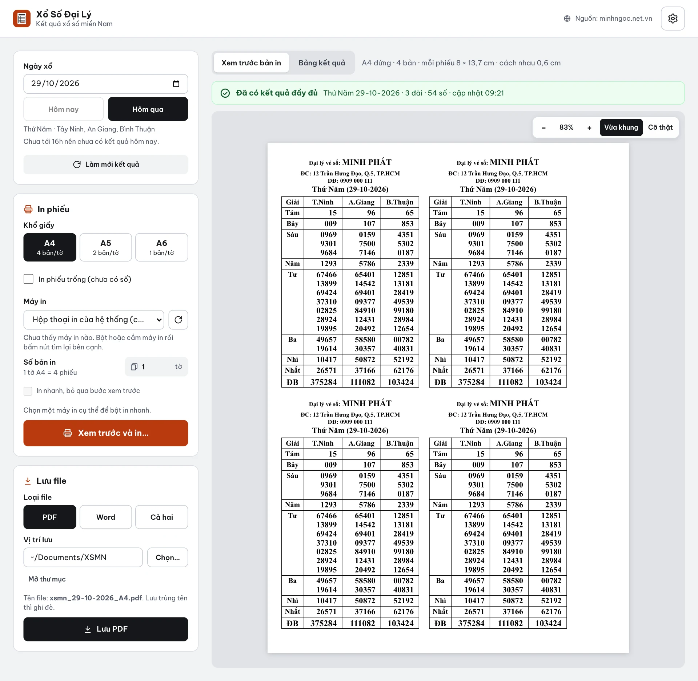

<p align="center">
  
</p>

<h1 align="center">Xổ Số Đại Lý</h1>

<p align="center">
  App máy tính lấy kết quả xổ số miền Nam và in phiếu dò cho đại lý vé số.<br>
  Windows (cả Windows 7) · macOS · Linux · tiếng Việt · miễn phí
</p>

<p align="center">
  <a href="https://github.com/ducdat147/xo-so-mien-nam/releases/latest"><b>Tải về</b></a> ·
  <a href="https://ducdat147.github.io/xo-so-mien-nam/">Hướng dẫn sử dụng</a> ·
  <a href="CHANGELOG.md">Có gì mới</a>
</p>



## App làm được gì

- Lấy kết quả XSMN theo ngày từ minhngoc.net.vn. Lúc đang quay, số mới hiện sau vài giây.
- In phiếu theo mẫu đại lý. Khổ A4 in 4 phiếu một tờ, A5 in 2, A6 in 1.
- Xem trước đúng như ra giấy, chọn máy in và số tờ ngay trong app.
- Lưu PDF hoặc Word để gửi đi hay mang ra tiệm in.
- Chỉnh tên, địa chỉ, số điện thoại đại lý, chọn đài, đổi thứ tự cột, font, cỡ chữ, kích thước phiếu.
- Sao lưu cài đặt ra file `.conf`, chép sang máy khác.

## Tải và cài

Tải file cài ở trang [Releases](https://github.com/ducdat147/xo-so-mien-nam/releases/latest):

| Máy | File |
|---|---|
| Windows 10, 11 | `xo-so-dai-ly-<phiên bản>-win-x64.exe` |
| Windows 7, 8, 8.1 (32 hoặc 64-bit) | `xo-so-dai-ly-win7-<phiên bản>.exe` |
| macOS chip Apple (M1, M2…) | `xo-so-dai-ly-<phiên bản>-mac-arm64.dmg` |
| macOS chip Intel | `xo-so-dai-ly-<phiên bản>-mac-x64.dmg` |
| Linux | `.AppImage` (chạy thẳng) hoặc `.deb` (Ubuntu, Debian) |

App chưa có chữ ký số nên lần mở đầu tiên hệ điều hành sẽ cảnh báo. Chỉ cần xử lý một lần:

| Máy | Cách mở lần đầu |
|---|---|
| Windows | Ở khung xanh "Windows đã bảo vệ PC của bạn", bấm **Thông tin thêm** rồi **Vẫn chạy** |
| macOS 15 trở lên | Mở app một lần, rồi vào Cài đặt hệ thống → Quyền riêng tư & Bảo mật → **Vẫn mở** |
| macOS 14 trở về trước | Chuột phải vào app → **Mở** → **Mở** |
| Linux (.AppImage) | `chmod +x` file rồi chạy |

Hướng dẫn từng bước, cách cập nhật và gỡ app có ở trang
[Tải và cài app](https://ducdat147.github.io/xo-so-mien-nam/huong-dan/tai-ve).

## Chạy từ mã nguồn

Cần Node.js 24 trở lên, git và `make`.

```bash
git clone https://github.com/ducdat147/xo-so-mien-nam.git
cd xo-so-mien-nam
make install     # cài thư viện
make dev         # chạy app, tự nạp lại khi sửa code
make check       # kiểm tra kiểu + unit test
make dist-mac    # đóng gói ở máy (dist-win, dist-win7, dist-linux) → app/release/
```

Gõ `make` để xem đủ danh sách lệnh. Chạy trong terminal của VS Code thì dùng `make` thay vì gọi
`npm` thẳng, vì VS Code đặt sẵn `ELECTRON_RUN_AS_NODE=1` làm app không mở được cửa sổ. Muốn thử với
dữ liệu riêng, không đụng cài đặt thật: `XSMN_USER_DATA=/tmp/xsmn-thu make dev`.

```text
app/src/core/      logic thuần có unit test: lấy kết quả, tính bố cục phiếu, xuất HTML/Word
app/src/main/      tiến trình chính Electron: cửa sổ, mạng, file, lệnh in
app/src/renderer/  giao diện React
app/test/          trang minhngoc mẫu, bản chụp file Word chuẩn
design/            thiết kế giao diện đã duyệt, PDF in mẫu
docs/SPEC.md       đặc tả đầy đủ
website/           trang hướng dẫn (VitePress), đăng lên GitHub Pages
```

Code `main/` và `core/` phải chạy được trên Node 16 vì bản Windows 7 dùng Electron 22. Các quy ước
khác và cách chạy test xem ở trang
[Chạy từ mã nguồn](https://ducdat147.github.io/xo-so-mien-nam/phat-trien/).

## Tài liệu

| Tài liệu | Dành cho |
|---|---|
| [Trang hướng dẫn](https://ducdat147.github.io/xo-so-mien-nam/) | Đại lý dùng app, người mới vào dự án |
| [docs/SPEC.md](docs/SPEC.md) | Đặc tả chi tiết, nguồn sự thật khi code |
| [design/](design/) | Giao diện đã duyệt, PDF in mẫu để so |
| [CLAUDE.md](CLAUDE.md) | Các quyết định đã chốt với chủ dự án |
| [CHANGELOG.md](CHANGELOG.md) | Thay đổi qua từng phiên bản |

## Phát hành

```bash
make version V=1.2.0                 # đặt số phiên bản trong app/package.json
# thêm mục "## 1.2.0 — <ngày>" lên đầu CHANGELOG.md
git commit -am "chore(release): 1.2.0"
git tag v1.2.0
git push && git push origin v1.2.0
```

Đẩy tag lên là GitHub Actions build đủ bộ cài cho macOS, Windows, Windows 7, Linux và gắn vào
Release, ghi chú lấy từ CHANGELOG. Chi tiết ở trang
[Phát hành bản mới](https://ducdat147.github.io/xo-so-mien-nam/phat-trien/phat-hanh).

## Giấy phép

[MIT](LICENSE) © 2026 DatTD
